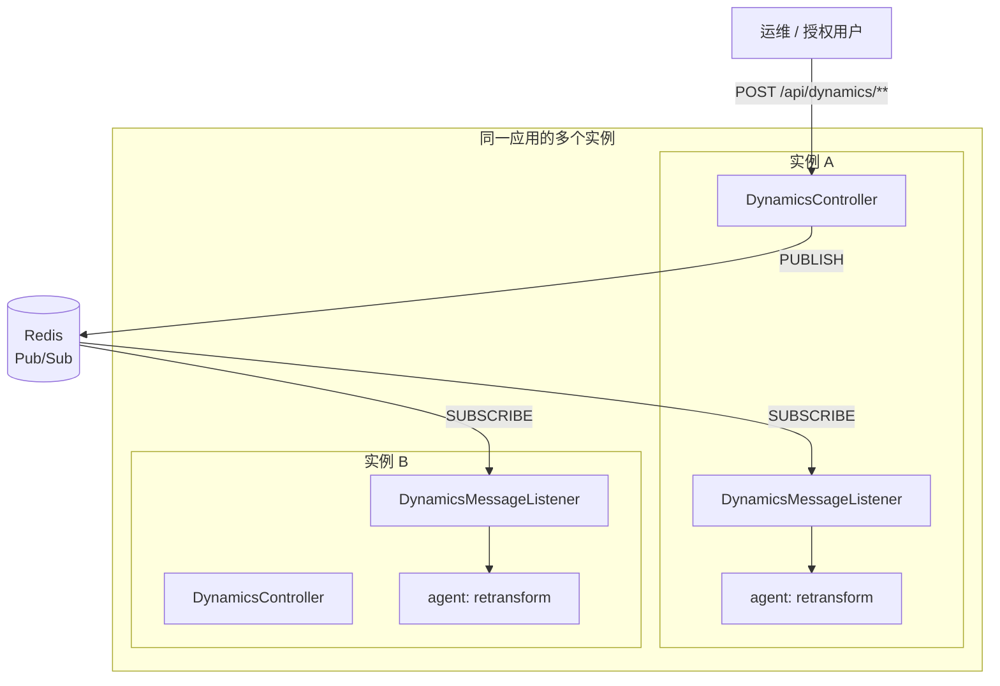
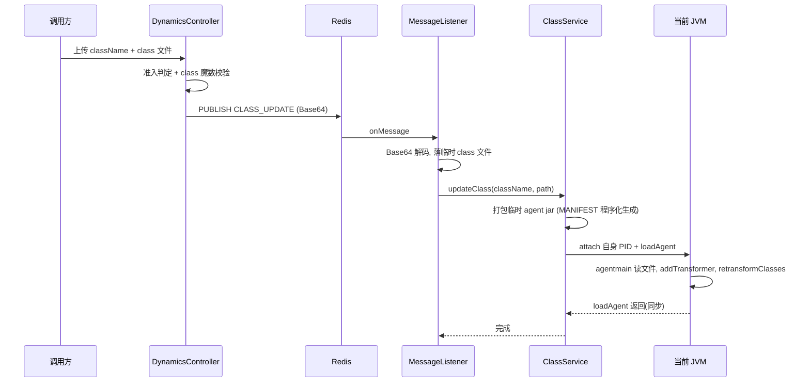

# dynamics

JVM 运行期热更新工具：不重启应用即可替换 **MyBatis SQL** 与 **已加载类的字节码**，并通过 Redis 发布/订阅让集群内所有实例同步生效。

适用于无法随时重启的线上系统：改一条慢 SQL、修一个方法体逻辑，不必走完整发版流程。

> **当前分支 `jdk17-plus`**：示例工程运行在 **Spring Boot 3.3 + JDK 17**，并已实测 Boot 3 运行期装配与集群同步。
> SDK 三模块（`agent` / `core` / `starter`）仍产出 **JDK 8 字节码**，兼容面与 `main` 分支一致。
> 需要 JDK 8 + Boot 2.7 的示例请切回 [`main`](../../tree/main)。

---

## 1. 模块说明

| 模块 | 说明 | 字节码 |
|------|------|--------|
| `dynamics-agent` | attach 到目标 JVM 后执行 `retransformClasses` 的 agent，**零第三方依赖** | JDK 8 |
| `dynamics-core` | 类热替换（attach 自身 JVM）与 MyBatis `MappedStatement` 的 SQL 替换，**不依赖 Spring** | JDK 8 |
| `dynamics-spring-boot-starter` | 自动装配 Redis 集群同步、热更新 REST 接口、可插拔权限校验 | JDK 8 |
| `dynamics-example` | Spring Boot 3.3 + H2 集成示例，演示两类替换的完整调用 | JDK 17 |

**SDK 三模块产出 JDK 8 字节码**，可直接用于 JDK 8 及以上的目标进程；本分支的 `example` 用 JDK 17。`starter` 的 Spring 相关依赖全部 `provided`，并同时提供 Boot 2.x（`spring.factories`）与 Boot 3.x（`AutoConfiguration.imports`）两个自动装配入口，两条路线均已实测（见 [docs/smoke-test.md](docs/smoke-test.md)）。

只做类热替换、不用 Spring 的场景，直接依赖 `dynamics-core` 即可。

---

## 2. 架构与执行链路

### 2.1 部署拓扑



要点：

- **接收请求的实例不直接执行替换**，只下发指令；包括自己在内的所有实例都由监听器执行，避免"发起实例生效、其他实例没生效"。
- 频道按应用隔离，默认 `{spring.application.name 首段}:dynamics:update:topic`。同一应用的所有实例必须落在同一频道，且**共用同一 Redis 实例与 database**。
- 类替换的字节码以 Base64 随消息下发，各实例落本地临时文件后 attach 自身 JVM 完成 `retransform`。

### 2.2 类热替换时序



`agent` 侧的 `RedefineClass` / `ClassTransformer` 是**真实源码**，构建期编译产出；`core` 运行时把这两个 class 从 classpath 读出、连同程序化生成的 MANIFEST 打成临时 agent jar，仓库内不含任何预编译二进制。

---

## 3. 快速开始

### 3.1 引入依赖

```xml
<dependency>
    <groupId>com.bjjw.dynamics</groupId>
    <artifactId>dynamics-spring-boot-starter</artifactId>
    <version>1.0.0-SNAPSHOT</version>
</dependency>
```

应用需已具备 `spring-boot-starter-web`、`spring-boot-starter-data-redis` 与 MyBatis（`SqlSessionFactory` Bean）。

> **JNA 必须存在**：`byte-buddy-agent` 把 `jna` / `jna-platform` 声明为 `provided`，`dynamics-core` 已显式引入。若在你的工程中排除了它们，attach 会抛 `NoClassDefFoundError: com/sun/jna/Platform`。

### 3.2 配置

```yaml
dynamics:
  enabled: true
  # 留空则按 {spring.application.name 首段}:dynamics:update:topic 推导
  topic:
  authorized-users-key: dynamics:authorized:users
  sql-session-factory: sqlSessionFactory
```

| 配置项 | 默认值 | 说明 |
|--------|--------|------|
| `dynamics.enabled` | `true` | 关闭后不装配任何 Bean 与接口 |
| `dynamics.topic` | 空 | Redis 频道；留空按应用名首段推导（`order-service-prod` → `order-service`） |
| `dynamics.authorized-users-key` | `dynamics:authorized:users` | 授权名单的 Redis key |
| `dynamics.sql-session-factory` | `sqlSessionFactory` | 请求未指定时使用的 `SqlSessionFactory` Bean 名 |

### 3.3 配置授权名单

名单是逗号分隔的用户名，**未配置该 key 时拒绝所有操作**：

```
SET dynamics:authorized:users "alice,ops-li"
```

### 3.4 接入自己的登录态

默认 `DynamicsUserProvider` 返回 `null`（即拒绝所有操作）。提供一个 Bean 即可对接：

```java
@Bean
public DynamicsUserProvider dynamicsUserProvider(ObjectFactory<HttpServletRequest> requestFactory) {
    return () -> requestFactory.getObject().getHeader("X-Dynamics-User");
}
```

上例是示例工程的演示写法。**生产请改为从自己的登录上下文取用户名**，不要信任可伪造的请求头。

若权限体系不止"用户名白名单"，直接替换整个 `DynamicsAuthorizer`：

```java
@Bean
public DynamicsAuthorizer dynamicsAuthorizer() {
    return operation -> myPermissionService.canHotPatch(operation) ? null : "无权限";
}
```

`authorize` 返回 `null` 表示放行，返回非 `null` 字符串即拒绝原因，会原样返回给调用方。

---

## 4. 接口清单

### 4.1 替换 MyBatis SQL

```
POST /api/dynamics/mybatis/replace-sql
```

| 参数 | 必填 | 说明 |
|------|------|------|
| `sqlStatementId` | 是 | 完整 statement id，如 `com.example.mapper.UserMapper.selectById` |
| `sql` | 是 | 新 SQL，可含 `<if>` / `<where>` / `<include>` 等动态标签，无需外层 `<script>` |
| `sqlSessionFactory` | 否 | 多数据源时指定 Bean 名，留空取配置默认值 |

```bash
curl -X POST http://127.0.0.1:7071/api/dynamics/mybatis/replace-sql \
  -H "X-Dynamics-User: alice" \
  --data-urlencode "sqlStatementId=com.bjjw.dynamics.example.mapper.UserMapper.selectById" \
  --data-urlencode "sql=SELECT id, name, 'PATCHED' AS dept FROM t_user WHERE id = #{id}"
```

`<include>` 由 MyBatis 在 mapper 解析期展开，运行期拼 `<script>` 不经过该步骤，因此本工具会手工补一次展开——直接传含 `<include>` 的 SQL 可以正常工作。

### 4.2 热替换类

```
POST /api/dynamics/class/update-by-upload
```

| 参数 | 必填 | 说明 |
|------|------|------|
| `className` | 是 | 完整类名 |
| `file` | 是 | 编译好的 `.class` 文件（multipart） |

```bash
curl -X POST http://127.0.0.1:7071/api/dynamics/class/update-by-upload \
  -H "X-Dynamics-User: alice" \
  -F "className=com.bjjw.dynamics.example.service.GreetingService" \
  -F "file=@target/patch/com/bjjw/dynamics/example/service/GreetingService.class"
```

两个接口都只返回"指令已发布"，**实际替换在各实例异步执行**，结果需查各实例日志（`com.bjjw.dynamics` 包）。响应中的 `messageId` 可用于串联日志。

响应 `data` 中的 `receivers` 是 Redis `PUBLISH` 回报的**订阅者数量**，用它判断指令是否真的送达：

- `receivers` 等于预期实例数 → 指令已投递到所有实例，再查日志确认执行结果。
- `receivers` 小于实例数 → 有实例没订阅上（正在重启、频道配错、Redis 不是同一实例），这些实例**不会生效**。
- `receivers` 为 0 → 接口直接返回失败（`code=500`，`msg` 含"指令未送达"），不会报假成功。

> Redis 发布/订阅不重放历史消息。实例在**订阅建立之前**收到的指令会被直接丢弃——刚启动就下发指令可能落空，此时 `receivers` 会小于实例数或为 0。

---

## 5. 能力边界

### 5.1 类热替换的限制

`retransformClasses` 是 JVM 的 schema-preserving 重定义，**只能改方法体**：

- 不能增删字段、方法，不能改方法签名、修饰符、继承关系
- 不能新增 lambda / 方法引用（会引入新的 `invokedynamic` 与合成方法）
- 目标类必须**已被加载**；未加载时 agent 记 `WARNING` 并且不生效
- 新字节码的编译目标不能高于目标进程的 JDK 版本

违反上述限制时 `retransformClasses` 抛异常，agent 记 `SEVERE` 日志，**不会静默成功**。

### 5.2 SQL 替换的限制

- 只支持 `DynamicSqlSource` 与 `RawSqlSource`（XML mapper 与常规注解 SQL）；`@SelectProvider` 等 `ProviderSqlSource` 会抛 `IllegalStateException`
- 运行期拼 `<script>` 只认 MyBatis 的动态标签，`<include>` 已单独补偿
- 替换的是 `MappedStatement` 实例，**进程重启后失效**，需重新下发

### 5.3 运行环境

- 目标进程 JDK 8 及以上
- **无需** `-Djdk.attach.allowAttachSelf=true`：attach 走 byte-buddy 的 JNA 直连通道，不受 JDK 9+ self-attach 限制影响（JDK 8 / 17 均已实测）
- 需要能在 `java.io.tmpdir` 写临时文件（agent jar 与待替换 class）
- 集群同步要求各实例共用同一 Redis 实例与 database

---

## 6. 构建

本分支用 **JDK 17** 构建：

```bash
mvn install -DskipTests
```

只想装 SDK、不构建示例：

```bash
mvn -pl dynamics-agent,dynamics-core,dynamics-spring-boot-starter -am install
```

`agent` / `core` / `starter` 的 `source/target` 为 `8`（产物 major version 52），`example` 为 `17`（major version 61）。用 JDK 17 构建时前三者仍产出 JDK 8 字节码。

实测记录与复现步骤见 [docs/smoke-test.md](docs/smoke-test.md)，示例工程的逐步操作见 [dynamics-example/README.md](dynamics-example/README.md)。

---

## 7. 许可证

Apache License 2.0，见 [LICENSE](LICENSE)。